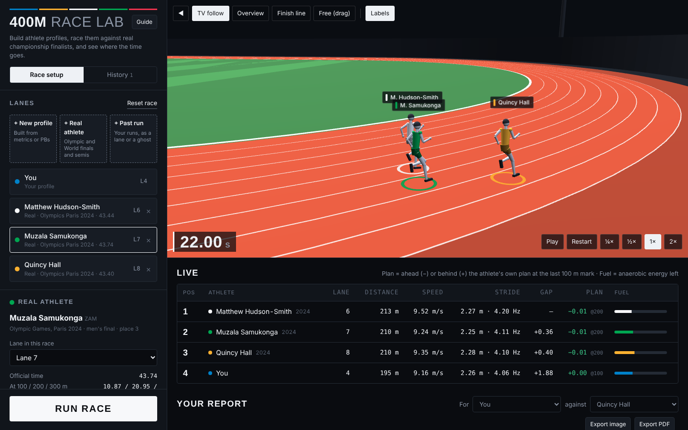
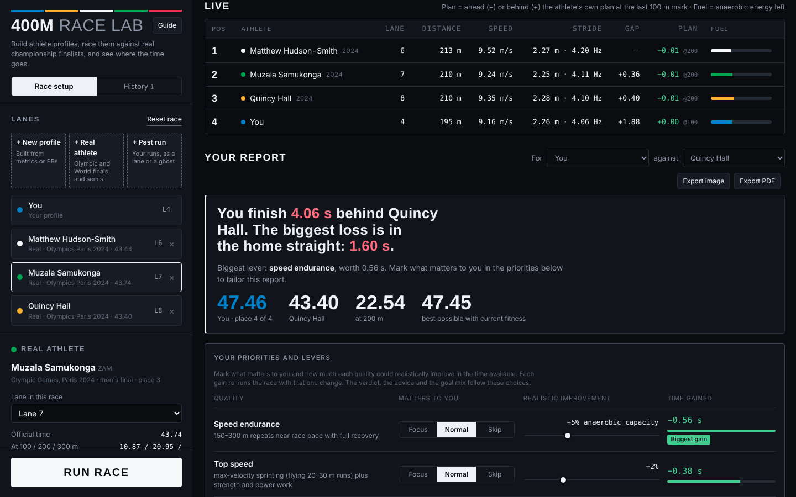

# 400m Race Lab

A 3D 400 m race simulator for athletes and coaches. You build an athlete profile, race it against real Olympic and World Championship performances or your own recorded runs, and get a report on where the race was won or lost and which improvements would gain the most time.

**[Open the live tool](https://claude.ai/artifact/4N9sZwkXCV8Yg72GXK4AQP)** · [User guide](docs/GUIDE.md) · [How accurate is it?](docs/VALIDATION.md)



## What it does

- **Predicts a race from an athlete's qualities.** Inputs are body mass, height, top speed, acceleration, reaction time, anaerobic capacity, VO₂max and a race plan. Profiles can also be fitted from a 100 m and a 400 m personal best.
- **Races real athletes.** The database holds 222 performances from Olympic and World Championship finals and semi-finals (2017–2025), using official splits, reaction times, lanes and conditions.
- **Uses your own runs.** You can type split times, or upload a GPS watch file (GPX, TCX, FIT) or a CSV from timing gates, a laser or a radar. The tool finds the 400 m in the recording and can race it, ghost it, or refit your profile from it.
- **Ghost runner.** A see-through runner in the same lane races a past version of the same athlete.
- **Tells you what to train.** The report ranks levers (top speed, speed endurance, aerobic power, acceleration, reaction, race plan) by time gained, follows the priorities you set, and answers "what would it take to run X?"
- **Keeps a history.** Every run is saved in sessions. You can reopen any run as it was, compare two runs side by side, and export a report as an image or PDF.



## How the model works

Each runner is a force-velocity sprinter (in the Keller and Ward-Smith tradition) with:

- a limited **anaerobic energy store**, plus an **aerobic supply** that switches on over the first seconds;
- force capacity that **falls as the store empties**, which produces the home-straight slowdown;
- **air drag** from frontal area (height and mass), wind along each part of the track, and air density from altitude, temperature and humidity;
- a **bend cost** on speed and energy that is higher in tight inside lanes, and a wet-track option;
- standard **track geometry** (84.39 m straights, 36.50 m kerb radius, 1.22 m lanes, staggers);
- a **race plan** controller: the athlete holds target splits while the energy lasts, then runs all-out from 300 m.

Fatigue settings are calibrated so the suggested plans match the average split shape of championship finalists. Real athletes' top speed and anaerobic capacity are fitted to their published splits.

**Accuracy.** Fitted profiles reproduce all 222 real performances within 0.08 s at every published split. On unseen races, a profile fitted to a semi-final predicted the final within 0.29 s on average when the semi was a full effort, against 0.33 s for an "average fade" rule. Details and limitations are in [docs/VALIDATION.md](docs/VALIDATION.md).

## Run it locally

No install is needed to use it: open `dist/index.html` in a browser. three.js loads from a CDN, and history is kept in the browser.

To rebuild and test, use Node 18 or later:

```bash
npm test            # model, data and file-reader tests
npm run build       # writes dist/index.html
npm run validate    # semi-final → final validation, writes validation/results.json
npm run fit         # refits every real performance into data/fits.js
```

## Project structure

```
src/model.js              race model (physics, energy, race plan, fitting)
src/parsers.js            readers for typed splits, CSV, GPX, TCX and FIT files
src/app/*.js              the interface: lanes, editor, 3D view, report, history, guide
src/index.template.html   page markup and styles
data/benchmarks.js        real championship splits, lanes, reaction times, conditions
data/fits.js              fitted profiles for every real performance
scripts/                  build, fitting and validation
test/                     node:test suites
docs/                     user guide, validation report, screenshots
```

## Data sources

- Official World Athletics results and race analysis sheets (Seiko timing).
- World Athletics, *Biomechanical Report for the IAAF World Championships London 2017: 400 m Men*.
- Athlete First split compilation (2025), for races without an official analysis sheet and for 50 m splits.

Race data belongs to its publishers and is used here for analysis.

## Author

Built by Thomas ([@ThomasMavro](https://github.com/ThomasMavro)) during the MSc in Sport Analytics & AI at Loughborough University London.
